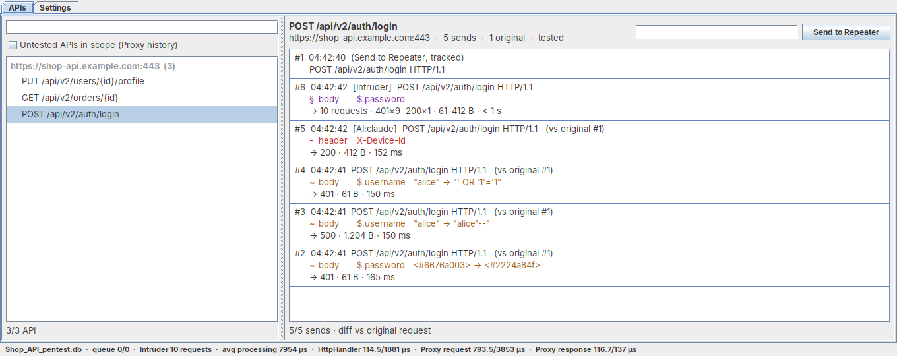
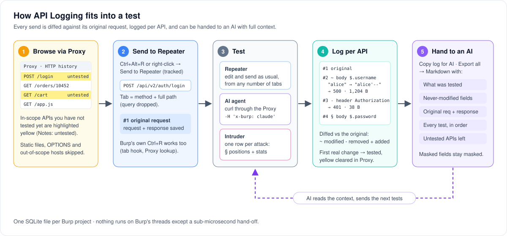
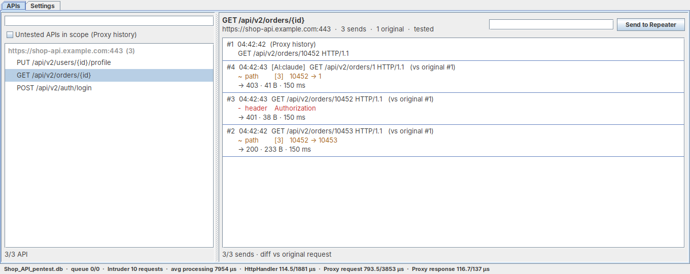
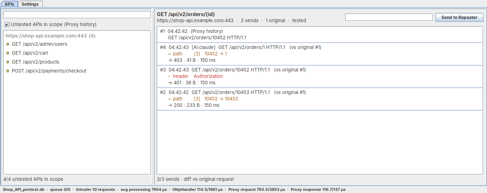
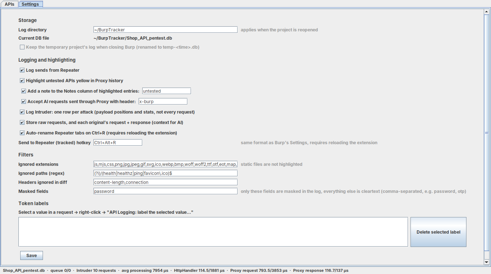
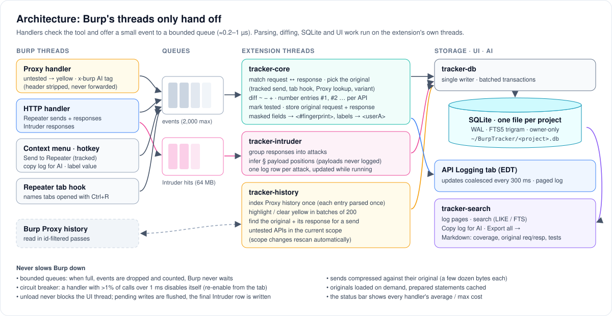

<h1 align="center">API Logging</h1>

<p align="center">
  <b>A Burp Suite extension that remembers every API test you (or your AI agent) run,<br>
  diffs it against the original request, and turns it into context an AI can read.</b>
</p>

<p align="center">
  
  
  
  
</p>

<p align="center">
  
</p>

When you pentest an API with dozens of endpoints, you lose track fast: which endpoint did you already poke, from
which of your 30 Repeater tabs, with which payloads, and what came back? An AI agent testing alongside you has the same
problem, only worse. API Logging keeps one log per API and answers three questions for each of them:

- **What is the baseline?** The original request, with its full request and response.
- **What has been tested?** Every send, from Repeater, an AI agent or Intruder, as a `~ - + §` diff against the original, with the response status, size and time.
- **What is left?** Fields of the original that no test touched yet, and in-scope APIs from Proxy history that were never tested.

## Contents

- [Features](#features)
- [How it works](#how-it-works)
- [Installation](#installation)
- [Quick start](#quick-start)
- [Usage](#usage)
- [Architecture](#architecture)
- [Storage and data](#storage-and-data)
- [Build from source](#build-from-source)
- [Limitations](#limitations)
- [Project structure](#project-structure)

## Features

- **One log per API**, merged across all Repeater tabs, AI agent requests and Intruder attacks. Entries are numbered per API (`#1` is the original, then `#2`, `#3`…).
- **Diff against the original request**: method, path segments, query, headers, cookies, JSON / form / multipart fields, XML and text bodies.
- **Untested APIs are highlighted yellow** in Proxy history, and the highlight clears itself once the API has been tested. You can also list every untested API in Burp's current scope.
- **Repeater tabs named after the endpoint**: `GET /iis-server/watchlist?customerId=0009003785` becomes a tab called `GET /iis-server/watchlist`.
- **AI agents as first-class testers**: requests sent with `curl -x <burp> -H 'x-burp: claude'` are logged as `[AI:claude]`, and the header never reaches the server.
- **AI-ready export**: one click copies an API's log as Markdown, with a coverage summary, never-modified fields, the original request and response, and every test. You can also export everything to one file.
- **Intruder in one row**: each attack becomes a single log entry listing its inferred payload positions and stats. Payloads are never stored.
- **Cleartext by default, masking on demand**: only the fields you list are masked, and labels such as `<userA>` stand in for tokens you name.
- **Never slows Burp down**: Burp's threads only do a sub-microsecond hand-off; a circuit breaker disables any handler that misbehaves.

## How it works

<p align="center">
  
</p>

1. **Browse** the target through Burp. In-scope requests to APIs you haven't tested yet are highlighted yellow, with the note `untested`.
2. **Send to Repeater (tracked)** with <kbd>Ctrl</kbd>+<kbd>Alt</kbd>+<kbd>R</kbd> or right-click. The tab is named `METHOD /full/path`, and the selected request and its response are saved as the API's **original request** (`#1`). Burp's own <kbd>Ctrl</kbd>+<kbd>R</kbd> works too: the tab is renamed and the original is looked up in Proxy history.
3. **Test** as usual from any Repeater tab, let an AI agent send requests through the Proxy, or run Intruder.
4. Every send is **diffed against the original** and appended to that API's log. The first meaningful change marks the API as tested and clears its yellow highlight.
5. **Hand the log to an AI** (right-click → *Copy log for AI*). The AI sees the baseline, what was tried, what came back and what's left, then proposes the next tests, which it can send itself with `x-burp`.

## Installation

1. Take the prebuilt `dist/api-tracker.jar` (or a release asset), or [build it yourself](#build-from-source).
2. In Burp: **Extensions → Installed → Add → Extension type: Java** → select the jar.
3. An **API Logging** tab appears. Logs are written to `~/BurpTracker/<project name>.db` (change the folder in *Settings*).

**Requirements:** Burp Suite Professional or Community 2025.x or later (built against Montoya API 2026.7; the hotkey needs the newer
hotkey API, and everything else works on older versions through the context menu). The jar targets Java 17 and bundles SQLite native
libraries for Windows x64, Linux and macOS.

## Quick start

1. Add the target to **Target → Scope** and browse the app through Burp.
2. In Proxy history, right-click a yellow request → **Send to Repeater (tracked)**.
3. Edit and send in Repeater. Try a few things: change an ID, drop the `Authorization` header, inject into a field.
4. Open **API Logging → APIs**, pick the API on the left, and read its log on the right.
5. Right-click the API → **Copy log for AI (this API)** and paste it into your AI assistant.

## Usage

### The log

<p align="center"></p>

Each API's log starts with its original request(s), followed by every test, newest first:

```
#1  10:21:07  (Proxy history)
    GET /api/v2/orders/10452 HTTP/1.1
#4  10:24:31  [AI:claude]  GET /api/v2/orders/1 HTTP/1.1   (vs original #1)
    ~ path    [3]   10452 → 1
    → 403 · 41 B · 150 ms
#3  10:23:58  GET /api/v2/orders/10452 HTTP/1.1   (vs original #1)
    - header  Authorization
    → 401 · 38 B · 150 ms
#2  10:23:40  GET /api/v2/orders/10453 HTTP/1.1   (vs original #1)
    ~ path    [3]   10452 → 10453
    → 200 · 233 B · 150 ms
```

| Mark | Meaning |
| --- | --- |
| `~` | modified, `old → new` |
| `-` | removed |
| `+` | added (`name = value`) |
| `§` | Intruder payload position |
| `→` | response status · size · time |
| `[AI:claude]` / `[Intruder]` | who sent it (no tag = Repeater) |
| `<#a1b2c3d4>` / `<userA>` | masked value / labeled token |

- **Search** the selected API's log with the box next to *Send to Repeater* (<kbd>Ctrl</kbd>+<kbd>F</kbd>, several words = AND). The box above the API list filters APIs by method, path or host (<kbd>Ctrl</kbd>+<kbd>Shift</kbd>+<kbd>F</kbd>).
- **Send to Repeater** (or double-click a row) reopens that exact request in a new Repeater tab.
- New sends appear at the top while you're viewing the top of the log; when you've scrolled down, a `↓ n new sends` button appears instead.

**When does an API count as "tested"?** As soon as one send differs meaningfully from the original. These changes still appear
in the log but don't count: body formatting only (whitespace, key order), rotating load balancer / analytics cookies
(`AWSALB*`, `__cf_bm`, `_ga*`…), browser and tracing headers (`Sec-Fetch-*`, `If-None-Match`, `traceparent`…), a refreshed CSRF
token value (removing it does count), and redirects Burp follows by itself.

### Untested APIs

<p align="center"></p>

- In Proxy history, in-scope requests to untested APIs are highlighted **yellow** with the note `untested`. Requests that already have a color or a note are left alone, as are OPTIONS, static files and paths you exclude.
- Tick **Untested APIs in scope (Proxy history)** to list every API seen in Proxy history that's within Burp's current scope and hasn't been tested. The list updates when you add or remove scope.
- Select one and click **Send to Repeater**: its latest Proxy request opens in Repeater and becomes the original, response included.

### Repeater tab names

**Send to Repeater (tracked)** (<kbd>Ctrl</kbd>+<kbd>Alt</kbd>+<kbd>R</kbd>, or right-click in Proxy, site map or any message editor) names the tab
`METHOD /full/path`, without the query string. Duplicate names get `(2)`, `(3)`. Tabs opened with Burp's own <kbd>Ctrl</kbd>+<kbd>R</kbd> are renamed
the same way when the extension can find Burp's Repeater tab bar, and tabs you've already renamed are left alone.

### AI agents (`x-burp`)

Have your agent send its requests through Burp's Proxy with an `x-burp` header:

```bash
curl -sk -x http://127.0.0.1:8080 \
  -H 'x-burp: claude' \
  -H 'Authorization: Bearer <token of userB>' \
  -H 'Content-Type: application/json' \
  -X POST 'https://shop-api.example.com/api/v2/orders' \
  --data '{"accountNo":"0002","sku":"A-17","qty":1}'
```

- The header is **stripped before the request leaves Burp**, Intercept doesn't hold the request, and the Proxy entry is colored purple with the note `[AI] claude`.
- The send is logged like a Repeater send, tagged `[AI:claude]`. `x-burp: 1` shows up as `[AI]`.
- AI requests are **never used as the original request**. If an API has no original yet, the AI's send is logged without a diff and doesn't mark the API as tested.
- The header is stripped in every tool, including when you resend an AI request from history. If it can't be stripped, the request is blocked rather than leaked.
- Tell your agent to add `x-burp` **only** when it goes through a Burp with this extension loaded; otherwise the header reaches the server.

### Handing the log to an AI

- **One API:** right-click it in the API list (or in its log) → **Copy log for AI (this API)**. Or right-click any request in Burp (Proxy, Repeater, site map) → **API Logging: copy this API's log for AI**. The Markdown goes to your clipboard.
- **Everything:** right-click in the API list → **Export all logs for AI…** writes one Markdown file, by default next to the database.

Each API section contains:

| Section | Content |
| --- | --- |
| Summary | tested or not, how many tests from Repeater / AI / Intruder, response codes seen |
| **What was tested** | every field modified / removed / added / fuzzed, with the values tried; method and path changes; Intruder attacks |
| **Never modified** | fields of the original request that no test has touched yet |
| **Original request** | the full request **and its response** (each capped at 8,000 characters in the export; the full text stays in the database) |
| **Tests** | every test, oldest first, with its changes and response |

A full export starts with a short guide that explains the notation to the AI, then an overview, and ends with the **untested APIs
in scope** from Proxy history. Masked fields stay masked everywhere, including in the original request and response.
👉 See a real export: [`docs/sample-ai-export.md`](docs/sample-ai-export.md).

### Intruder

- Nothing to configure: responses are grouped into **attacks**, and payload positions are inferred by comparing requests (any field that takes two or more values). This works for sniper, battering ram, pitchfork and cluster bomb, including payloads in the path, headers, cookies, query, nested JSON, forms, multipart and XML/text.
- Each attack is **one log row**: the template request line with `§` at the positions, the positions themselves, and stats (request count, statuses, length range, duration). The row updates while the attack runs. **Payloads are never logged**, and fuzzed names show up as `(param name)`, `(header name)` or `(field name)`.
- An attack ends after a quiet period: max(8 s, 5 × the average interval), at least 30 s from the 11th request on, at most 2 min. This keeps slow attacks and time-based SQLi in a single row.
- An attack with payload positions marks the API as tested. Path brute-forcing (`/api/§`) is logged under the template `/api/§`.

### Masked fields and labels

- Everything is logged in **cleartext**. To hide a field, add its name to **Settings → Masked fields** (comma-separated, e.g. `password, otp, authorization`). Its values are then stored as a fingerprint `<#a1b2c3d4>` (HMAC-SHA256 with a random per-project key; not reversible).
- A listed name matches the field itself or any word of it, ignoring case and plurals: `token` masks `token`, `accessToken`, `x-csrf-token` and `tokens`, but not `tokenizer`.
- **Labels:** select a token in any request → right-click → **API Logging: label the selected value…** → `userA`. That value then shows as `<userA>` in the log and in exports, which makes privilege tests (`<userA>` → `<userB>`) readable. Typing `userA` in the log search box finds every entry that uses it.

### Settings

<p align="center"></p>

| Setting | Default | What it does |
| --- | --- | --- |
| Log directory | `~/BurpTracker` | Where the per-project databases live (applies when the project is reopened) |
| Keep the temporary project's log | off | Keep the log of a temporary Burp project instead of deleting it on close |
| Log sends from Repeater | on | Master switch for logging |
| Highlight untested APIs yellow | on | Proxy highlighting, plus the optional `untested` note |
| Accept AI requests with header | `x-burp` | Name of the AI header (stripped, logged as `[AI:<value>]`) |
| Log Intruder | on | One row per attack |
| Store raw requests, and each original's request + response | on | Needed for *Send to Repeater* from the log and for the AI export's request/response |
| Auto-rename Repeater tabs on Ctrl+R | on | Tab hook for Burp's own Send to Repeater |
| Send to Repeater (tracked) hotkey | `Ctrl+Alt+R` | Same format as Burp's hotkey settings |
| Ignored extensions / paths | static files, `/health`… | Never highlighted, never listed as untested |
| Headers ignored in diff | `content-length, connection` | Left out of diffs and of "never modified" |
| Masked fields | *(empty)* | See [Masked fields and labels](#masked-fields-and-labels) |

## Architecture

<p align="center">
  
</p>

The main design rule: **never slow Burp down.** Burp's handlers only check which tool sent the request, do a hash lookup and
`offer` a small event to a bounded queue. Everything else runs on the extension's own threads: parsing, diffing, SQLite, Proxy
history scans, search and export.

| Hot path (`./gradlew bench`, after JIT warm-up; upper bounds) | Cost |
| --- | --- |
| Proxy: new request, no AI header | ~0.35 µs |
| Proxy: yellow-highlight decision | ~0.7–1.0 µs |
| HTTP handler: Proxy request (early exit) | ~0.2 µs |
| HTTP handler: Repeater request (offer to queue) | ~0.6 µs |
| HTTP handler: Intruder response (offer to its own queue) | ~0.5 µs |
| Worker: parse + diff a 6 KB JSON request | ~0.1–0.2 ms |
| Intruder thread: infer payload positions, 3 KB JSON body | ~10–15 µs |

- **Proxy history** is scanned only when there are new entries (at most every 30 s) or an API has just become tested. Each scan is a single pass that compares ids only, and each entry is parsed once in its lifetime because the index is stored in the database. Large histories are caught up 50,000 entries at a time.
- **Highlighting** changes run in batches of 200 with 50 ms pauses. The UI coalesces updates every 300 ms, paints log cells itself with cached sizes, and loads the log in pages of 200.
- **Storage:** each send's raw request is compressed using its original as the deflate dictionary, which usually leaves a few dozen bytes. Originals are loaded on demand and SQL statements are cached.
- **Safety nets:** queues drop rather than block (drops are counted). A **circuit breaker** disables any handler with more than 1% of calls over 1 ms, and the tab's status bar shows every handler's average and max cost. Unload never blocks the UI thread.

## Storage and data

- One SQLite file (WAL mode) per Burp project, matched by project id. Files are readable by the owner only (POSIX `0600`/`0700`, Windows ACL owner + SYSTEM). If a second Burp instance opens the same project, it gets the database read-only.
- The log text and its full-text index (FTS5 trigram) are cleartext, except masked fields and labeled values.
- **Raw requests** are stored compressed, up to 4 MB each. **Each original request** also keeps a readable request and response (`originals.request_text` / `response_text`, up to 256 K characters each; binary bodies become a placeholder). These are the context the AI export uses, and you can query them directly:

```bash
sqlite3 ~/BurpTracker/<project>.db \
  "SELECT seq, first_line, substr(response_text, 1, 200) FROM originals ORDER BY api_id, seq"
```

> ⚠️ The database contains real requests, tokens and responses. Treat it like the Burp project file itself.

## Build from source

Everything needed is in `libs/` (Montoya API as `compileOnly`, sqlite-jdbc bundled into the jar), so builds work offline:

```bash
./gradlew build            # compile + self-test → dist/api-tracker.jar
./gradlew integrationTest  # run the real extension on a fake Burp (opens a Swing window)
./gradlew bench            # measure the hot-path handlers
./gradlew screenshots      # regenerate docs/images/*.png and docs/sample-ai-export.md (needs a display)
```

Without Gradle, use `./build.sh` (Linux/macOS) or `build.ps1` (Windows; needs JDK 17+). On a headless Linux box, run the GUI tasks under `xvfb-run`.

- **SelfTest** (366 checks): key normalization, request parsing, JSON, masking, diffing, noise rules, the worker against a real SQLite (request/response matching, picking the original, Proxy lookups, variants, AI requests, numbering, stored request/response context), Intruder position inference, storage, search and the AI export.
- **BurpIntegrationTest** (74 checks): the real extension on a fake Burp. Covers yellow highlighting, the `x-burp` header, tracked sends, the tab hook, Intruder, scope changes, the UI (including after Burp re-applies its theme), the AI copy from both context menus, and a clean unload.

## Limitations

- A single-endpoint GraphQL API (`/graphql`) is one API: all operations share a log.
- Only sends made after the extension was loaded are logged; earlier Repeater history can't be read.
- Responses are stored for **original requests**. For tests, only status, size and time are kept.
- Without a tracked send or a working tab hook, the original is the latest Proxy request for the same API. Paths seen in Proxy history are always separate APIs. A path never seen there that differs from a known API by exactly one segment (e.g. `/users/john` → `/users/alice`) is merged into it; otherwise the first send becomes its own original.
- Two Intruder attacks running at the same time against the same endpoint are merged into one row.
- Depending on your Burp version, check these in Burp's **Output** tab:
  - whether the <kbd>Ctrl</kbd>+<kbd>R</kbd> tab hook attached ("Attached to the Repeater tab area");
  - whether yellow is cleared on old Proxy entries immediately;
  - whether the hotkey conflicts with one of yours (change it in Settings, then reload the extension).

## Project structure

```
src/main/java/apitracker/
  ApiTrackerExtension, App   entry point, wiring, lifecycle
  core/    Tracker (worker), IntruderTracker, FieldLocator, Diff, Noise, ParsedReq, JsonFlattener,
           ApiKeys, Redactor (masking), HttpText, TabNames, StatusIndex, KeyRegistry, Settings, Events
  store/   Db (file, permissions, lock, schema, migrations), DbWriter (batched writes), Repo (reads, FTS5), Rows, Zip
  burp/    TrackerHttpHandler, ProxyTagger (yellow + x-burp), HistorySync, TrackedSend, RepeaterTabHook,
           BurpRequest / BurpResponse, SettingsStore
  ui/      TrackerTab, ApiView, SettingsView, Markdown (AI export), Labels, SearchTerms, UiBus, LockedList
src/test/java/apitracker/    SelfTest, BurpIntegrationTest, FakeBurp, HotPathBench, Screenshots
docs/                        images used in this README, sample AI export
libs/                        montoya-api (compileOnly), sqlite-jdbc (bundled)
```

## Disclaimer

API Logging is a tool for **authorized** security testing. Only test systems you have explicit permission to test.
"# API-Logging" 
"# API-Logging" 
